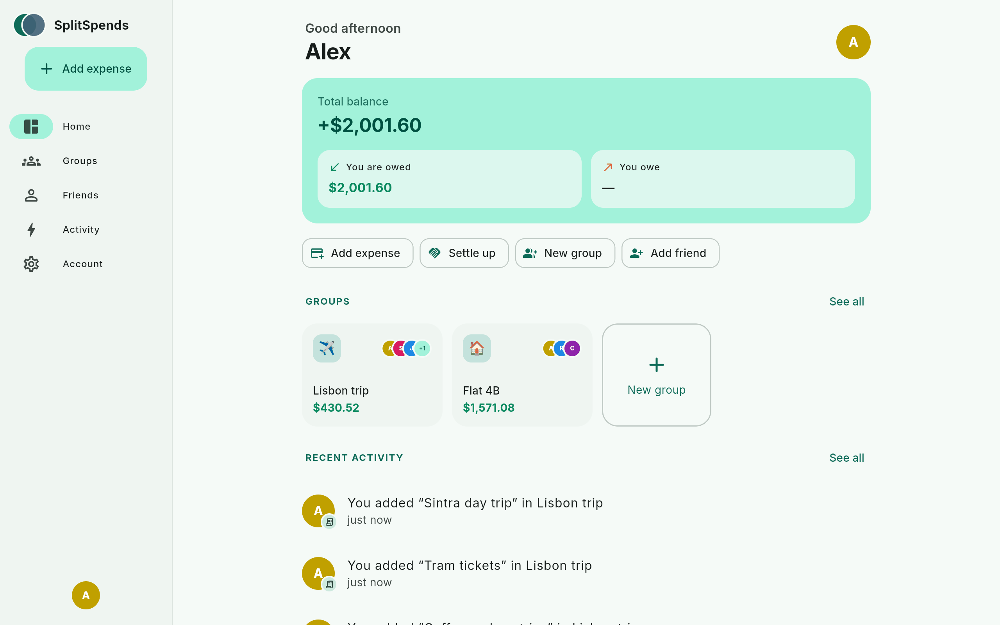
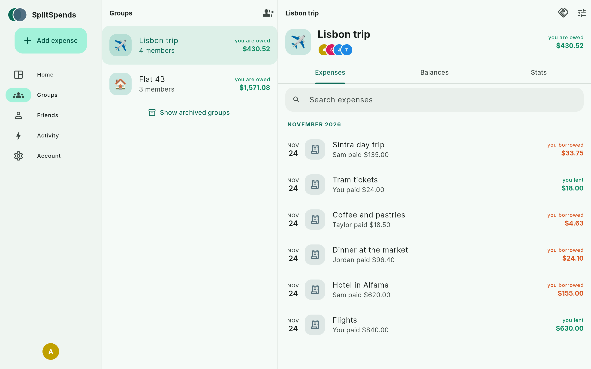
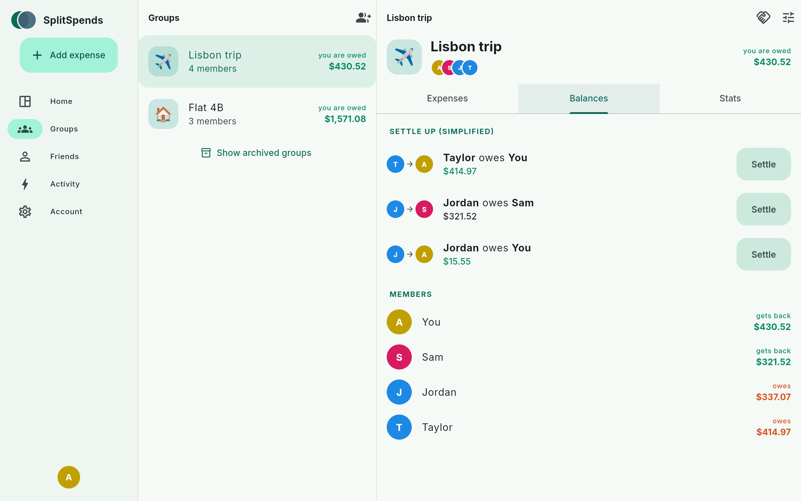
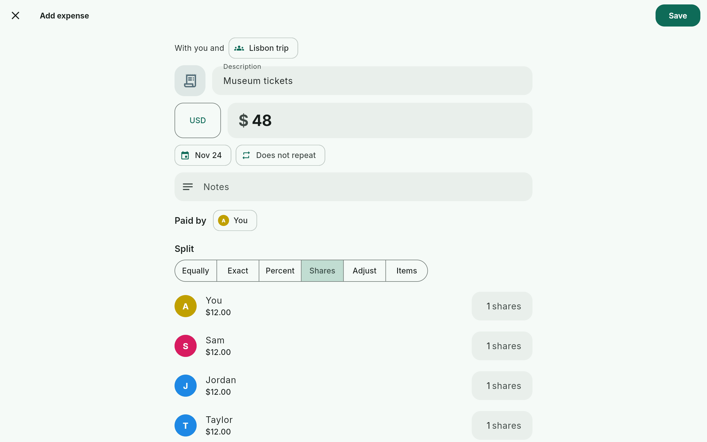
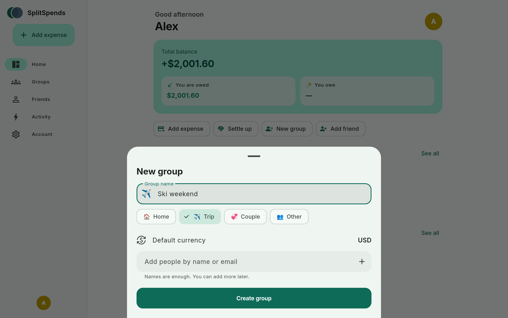
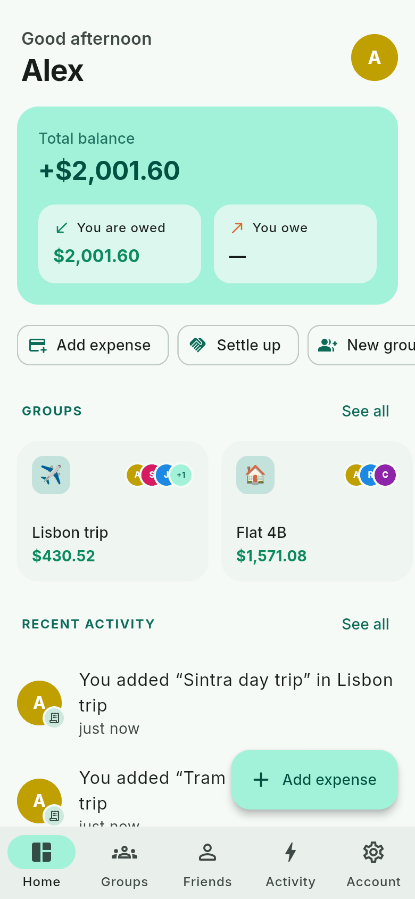
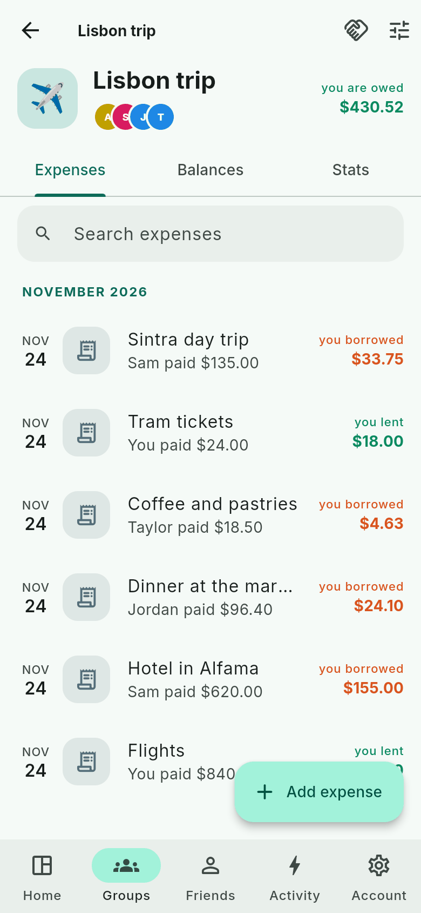
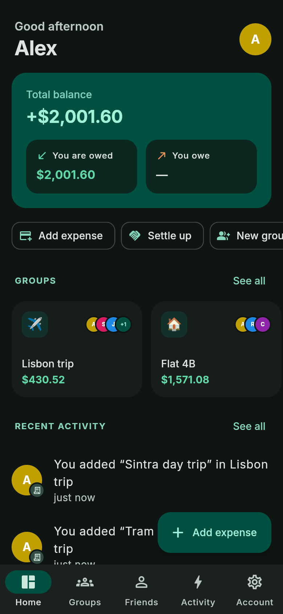
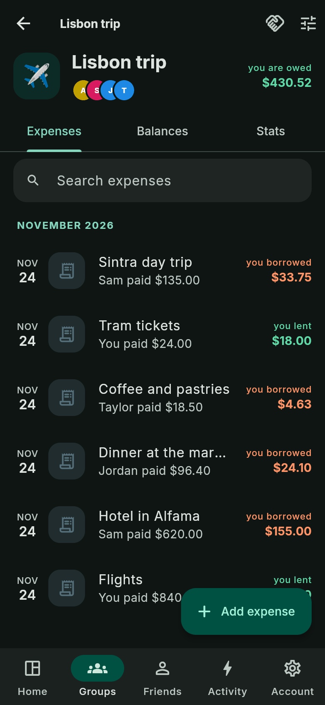

# SplitSpends

Self-hosted expense splitting for friends, flatmates and trips. Everything you would use Splitwise for, with no paid tier, no ads and no limits, on your own server.



- **Every split**: equal, exact amounts, percentages, shares, adjustments, and itemized bills with tax and tip.
- **Groups and friends**: trips, homes, couples; non-group expenses; multiple payers; per-currency balances.
- **Settle up**: simplified debts, recorded payments, friend and group balances that always add up.
- **Everything else**: comments, activity feed, email notifications, recurring expenses, search, charts, CSV export, undo delete.
- **Passwordless login** with one-time codes sent from any SMTP provider (Gmail, Microsoft 365, SES, Postmark...).
- **AI, if you want it**: snap a receipt and split it item by item, or type "dinner 60 paid by me split with Sam". Works with Claude or any OpenAI-compatible server, including local models. Off by default.
- **MCP server** so assistants like Claude can check balances and add expenses for you.
- **No account needed**: use it entirely on your phone or in your browser. Connect a server only when you want sync, sharing and emails.
- **One app** for iOS, Android and the web (Flutter), backed by a small Go server and PostgreSQL.

## Screenshots

| Group expenses | Simplified balances |
| -------------- | ------------------- |
|  |  |
| **Split by shares** | **New group** |
|  |  |

On a phone, in light and dark mode:

| | | | |
| - | - | - | - |
|  |  |  |  |

The web app shown here runs entirely in the browser with no account, and makes no requests to any server other than its own.

## Hosting

Home lab, any VPS, Render (one click), Google Cloud Run or AWS Lambda, including free options: see [docs/HOSTING.md](docs/HOSTING.md).

## Quick Start (Docker)

```bash
cp deploy/.env.example deploy/.env    # set SECRET_KEY, BASE_URL, POSTGRES_PASSWORD and SMTP
docker compose -f deploy/docker-compose.yml up -d --build
```

Open `http://localhost:8080`, sign in with your email, and you are the first user. In the default `invite` mode, people join when you add them to a group or as a friend. Put a TLS reverse proxy (Caddy, Traefik, nginx) in front for public use and set `TRUST_PROXY=true`.

All settings: [docs/ENVIRONMENT.md](docs/ENVIRONMENT.md).

## Mobile Apps

The Flutter app in [`app/`](app/README.md) builds for iOS and Android. On first launch it asks for your server URL.

## For Developers

| Need | Read |
| ---- | ---- |
| Local setup and layout | [docs/DEV.md](docs/DEV.md) |
| HTTP API contract | [docs/API.md](docs/API.md) |
| MCP server | [docs/MCP.md](docs/MCP.md) |
| Splitwise study and feature parity | [docs/FEATURES.md](docs/FEATURES.md) |
| Hosting options and security checklist | [docs/HOSTING.md](docs/HOSTING.md) |
| Architecture decisions | [docs/adr/README.md](docs/adr/README.md) |

## License

[MIT](LICENSE)
