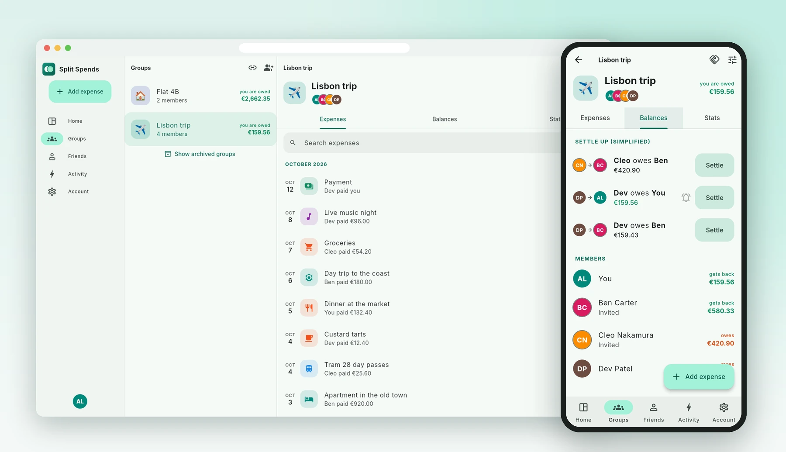

<h1 align="center">SplitSpends</h1>

<p align="center">
  <strong>Split bills with friends, flatmates and trips. Self-hosted, private, and every feature included.</strong>
</p>

<p align="center">
  <a href="https://github.com/Hostworthy/SplitSpends/actions/workflows/ci.yml"></a>
  <a href="LICENSE"></a>
  
</p>

<p align="center">
  
</p>

SplitSpends keeps track of who paid what and who owes whom, so shared costs never get awkward. It covers everything people use Splitwise for (groups, every kind of split, receipts, settling up) without a paid tier, ads or daily limits. Use it on your own, or run your own server so everyone in the group sees the same numbers.

## How It Works

1. **Start right away, no account.** Open the app on your phone or in a browser and choose *Use on this device*. Groups, expenses and balances stay on that device.
2. **Add expenses the way they really happened.** Split equally, by exact amounts, percentages, shares or adjustments, or item by item from a receipt with tax and tip. Several people can pay for one bill.
3. **Settle up with fewer payments.** SplitSpends works out who owes whom, simplifies the debts in a group to the fewest transfers, and records payments when people pay each other back.
4. **Connect a server when you want to share.** Point the app at a SplitSpends server that you or a friend hosts, sign in with a code sent to your email (no password), and your on-device data uploads in one step. From then on your friends see the same groups, get email notifications, and you can use it on all your devices.

## Features

- **Every split**: equal, exact, percent, shares, adjustment and itemized; multiple payers; recurring expenses.
- **Groups and friends**: trips, homes and couples, expenses outside groups, people added by name or email. Invite with a link or QR code.
- **Less typing**: each group has its own currency and an optional default split (rent 60/40), plus your own categories.
- **Clear money**: amounts are stored as exact integers, so balances always add up to the cent.
- **Nudges**: email and push notifications (web and Android, no Google account needed) and one-tap reminders to settle up.
- **Everything else**: comments, activity feed, search, charts, CSV export, undo delete, backup and restore, dark mode.
- **Works offline**: on-device mode needs no network; connected mode queues changes and syncs when you are back online.
- **Optional AI**: snap a receipt to split it line by line (receipts from abroad are converted to the group's currency), or type "dinner 60 paid by me split with Sam". Works with Claude or any OpenAI-compatible server, including local models.
- **AI assistants**: a built-in MCP server lets assistants such as Claude check balances and add expenses for you.
- **Small and portable**: one Go binary and PostgreSQL. Runs on a home server, a VPS, Render, Google Cloud Run or AWS Lambda.

## Get Started

**Just using it?** Open the app and choose *Use on this device*. You can connect to a server later.

**Hosting a server for your group?** With Docker:

```bash
git clone https://github.com/Hostworthy/SplitSpends && cd SplitSpends
cp deploy/.env.example deploy/.env    # set SECRET_KEY, BASE_URL, POSTGRES_PASSWORD and SMTP
docker compose -f deploy/docker-compose.yml up -d --build
```

Open `http://localhost:8080` and sign in with your email: the first account belongs to you, and others join when you add them. For HTTPS, a homelab setup with automatic certificates, free cloud options and a security checklist, see the [hosting guide](docs/HOSTING.md). Every setting is in [docs/ENVIRONMENT.md](docs/ENVIRONMENT.md).

**Mobile apps:** [`apps/apk`](apps/apk) and [`apps/ios`](apps/ios) build the phone apps from the same code as the web app ([`packages/client`](packages/client/README.md)); `make apk` builds the Android app.

## Documentation

| Need | Read |
| --- | --- |
| Hosting options, costs and security | [docs/HOSTING.md](docs/HOSTING.md) |
| Settings | [docs/ENVIRONMENT.md](docs/ENVIRONMENT.md) |
| MCP server for AI assistants | [docs/MCP.md](docs/MCP.md) |
| HTTP API | [docs/API.md](docs/API.md) |
| Feature comparison with Splitwise | [docs/FEATURES.md](docs/FEATURES.md) |
| Development setup and code layout | [docs/DEV.md](docs/DEV.md) |
| Architecture decisions | [docs/adr/README.md](docs/adr/README.md) |

## License

SplitSpends is source-available under the [PolyForm Noncommercial License 1.0.0](LICENSE).

- **Free for noncommercial use.** Use it, self-host it, change it and share it for personal, family, hobby, study and research use. Charities, schools, public research bodies and government institutions may use it too.
- **Commercial use needs permission.** Examples: running it as a paid or ad-supported service, bundling it into a commercial product, or using it inside a business. Ask for a commercial license by opening an issue at <https://github.com/Hostworthy/SplitSpends/issues>.

When you share copies or changed versions, include the license and the `Required Notice` line at the top of [LICENSE](LICENSE). Third-party components keep their own licenses (for example the bundled Inter and Noto fonts, under the SIL Open Font License in `packages/client/assets/fonts/` and `apps/web/web/fonts/fallback/`). Contributions are accepted under the same license.
