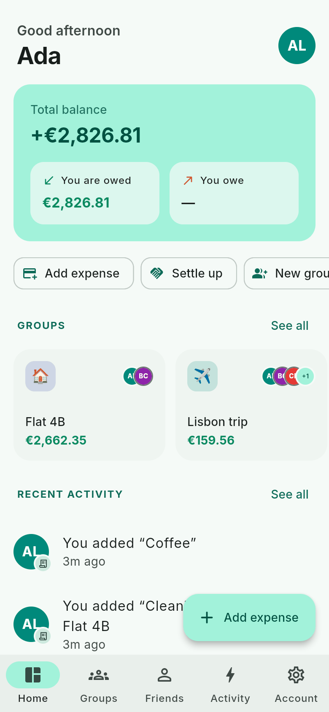
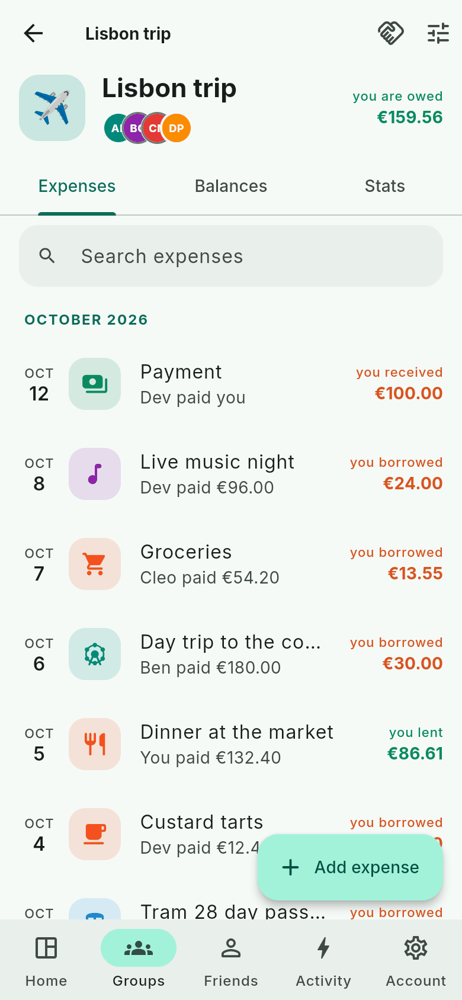
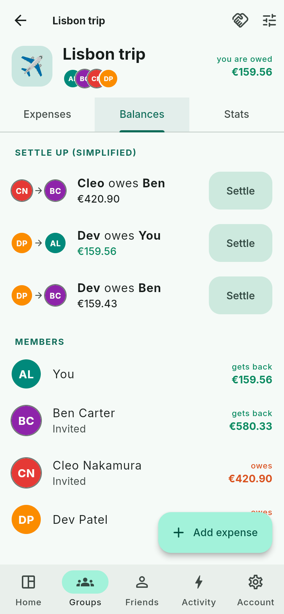
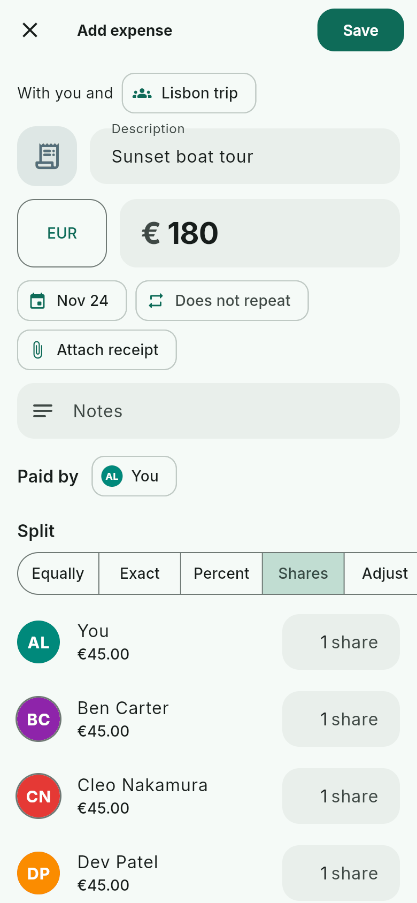
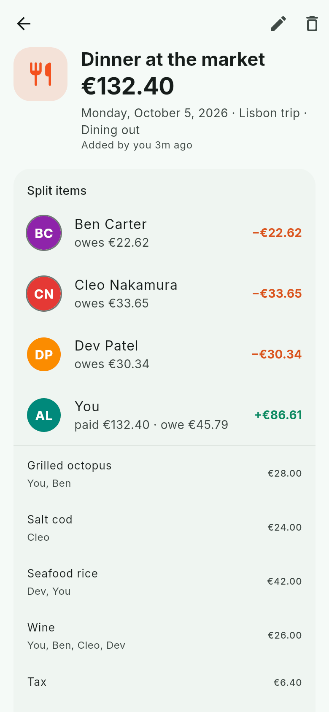
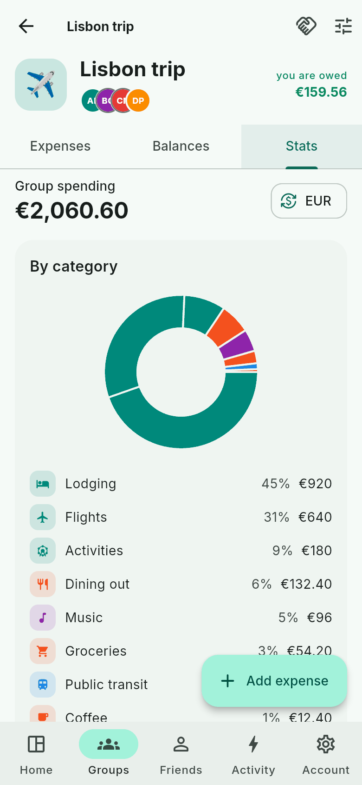
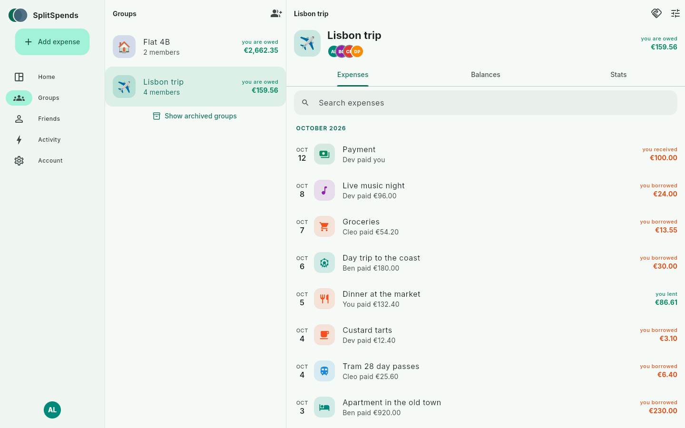
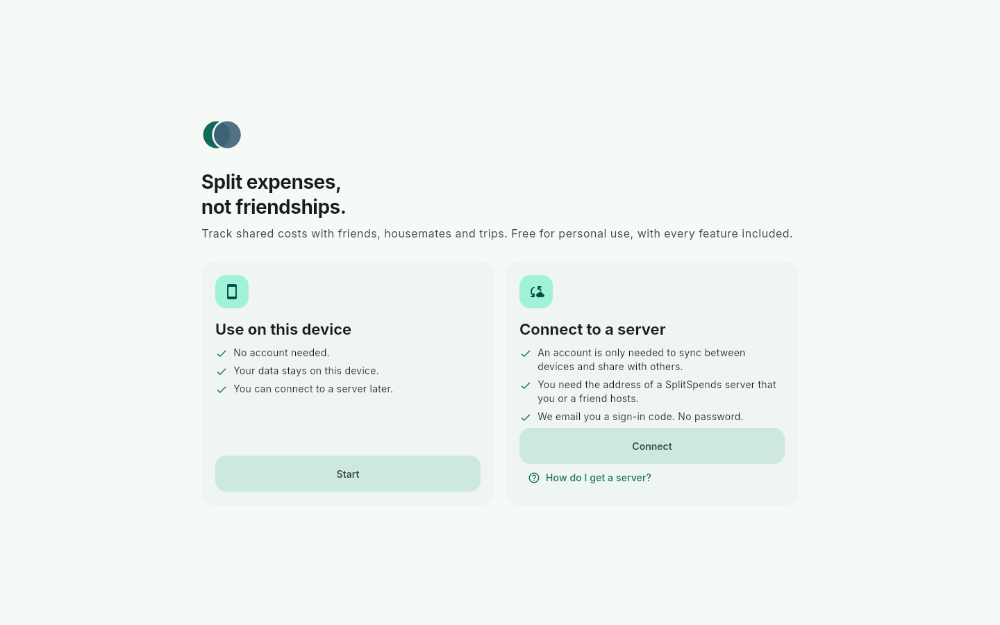

# SplitSpends

Self-hosted expense splitting for friends, flatmates and trips. Everything you would use Splitwise for, with no paid tier, no ads and no limits, on your own server. Free for personal and other noncommercial use (see [License](#license)).

- **Every split**: equal, exact amounts, percentages, shares, adjustments, and itemized bills with tax and tip.
- **Groups and friends**: trips, homes, couples; non-group expenses; multiple payers; per-currency balances.
- **Settle up**: simplified debts, recorded payments, friend and group balances that always add up.
- **Everything else**: comments, activity feed, email notifications, recurring expenses, search, charts, CSV export, undo delete.
- **Passwordless login** with one-time codes sent from any SMTP provider (Gmail, Microsoft 365, SES, Postmark...).
- **AI, if you want it**: snap a receipt and split it item by item, or type "dinner 60 paid by me split with Sam". Works with Claude or any OpenAI-compatible server, including local models. Off by default.
- **MCP server** so assistants like Claude can check balances and add expenses for you.
- **No account needed**: use it entirely on your phone or in your browser. Connect a server only when you want sync, sharing and emails.
- **One app** for iOS, Android and the web (Flutter), backed by a small Go server and PostgreSQL.

## Screenshots

<p align="center">
  
  
  
</p>
<p align="center">
  
  
  
</p>

On a desktop browser the same app switches to a side rail with list and detail side by side:

<p align="center">
  
</p>

And it starts with an honest choice, no account required:

<p align="center">
  
</p>

## Hosting

Home lab, any VPS, Render (one click), Google Cloud Run or AWS Lambda, including free options: see [docs/HOSTING.md](docs/HOSTING.md).

## Quick Start (Docker)

```bash
cp deploy/.env.example deploy/.env    # set SECRET_KEY, BASE_URL, POSTGRES_PASSWORD and SMTP
docker compose -f deploy/docker-compose.yml up -d --build
```

Open `http://localhost:8080`, sign in with your email, and you are the first user. In the default `invite` mode, people join when you add them to a group or as a friend. Put a TLS reverse proxy (Caddy, Traefik, nginx) in front for public use and set `TRUST_PROXY=true`.

All settings: [docs/ENVIRONMENT.md](docs/ENVIRONMENT.md).

## Mobile Apps

The Flutter app in [`app/`](app/README.md) builds for iOS and Android. On first launch it asks for your server URL.

## For Developers

| Need | Read |
| ---- | ---- |
| Local setup and layout | [docs/DEV.md](docs/DEV.md) |
| HTTP API contract | [docs/API.md](docs/API.md) |
| MCP server | [docs/MCP.md](docs/MCP.md) |
| Splitwise study and feature parity | [docs/FEATURES.md](docs/FEATURES.md) |
| Hosting options and security checklist | [docs/HOSTING.md](docs/HOSTING.md) |
| Architecture decisions | [docs/adr/README.md](docs/adr/README.md) |

## License

SplitSpends is source-available under the [PolyForm Noncommercial License 1.0.0](LICENSE).

- **Free for noncommercial use.** Use it, self-host it, change it and share it for personal, family, hobby, study and research use. Charities, schools, public research bodies and government institutions may use it too.
- **Commercial use needs permission.** Examples: running it as a paid or ad-supported service, bundling it into a commercial product, or using it inside a business. Ask for a commercial license by opening an issue at <https://github.com/Hostworthy/SplitSpends/issues>.

When you share copies or changed versions, include the license and the `Required Notice` line at the top of [LICENSE](LICENSE). Third-party components keep their own licenses (for example the bundled Inter font, under the SIL Open Font License in `app/assets/fonts/`).

Contributions are accepted under the same license.
