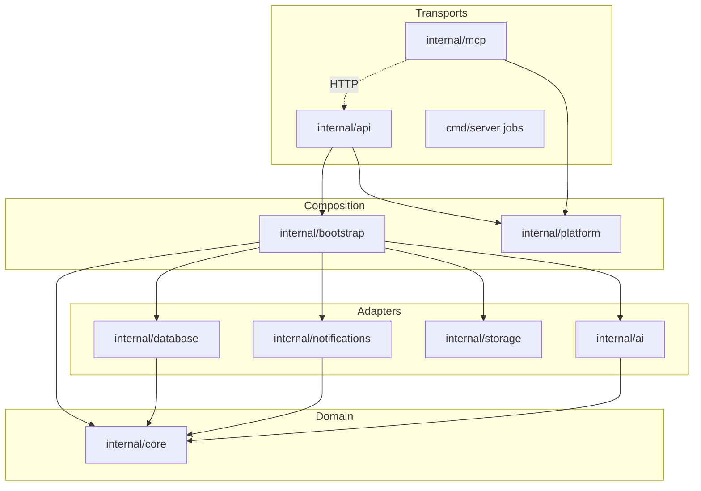

# ADR-001: Domain-Driven Design and Clean Architecture

## Status

Accepted

## Context

SplitSpends has real business rules (split methods, rounding, debt simplification, who may see what) and several ways in: the HTTP API, the MCP server, background jobs. Rules must stay independent of HTTP, PostgreSQL, SMTP and AI vendors so they can be tested alone and adapters can change.

## Decision

Dependencies point inward. `internal/core` is the centre and imports no infrastructure.

### Bounded Contexts

| Context | Owns |
| ------- | ---- |
| `user` | Identity, profile, notification preferences, invited users |
| `auth` | Login codes, sessions, API tokens, signup policy |
| `friend` | Friendships (explicit plus group co-members) |
| `group` | Groups and membership |
| `expense` | Expenses, payments, split rules, comments, recurrence, categories |
| `balance` | Pure balance math over ledger entries: nets, pairwise debts, simplification |
| `activity` | Append-only feed |
| `receipt` | Receipt images and AI scanning |
| `assist` | Natural-language expense drafts |
| `stats` | Spending summaries |

### Layout Inside a Context

- Entity types with their invariants and `New`/`Apply` style constructors.
- `Repository` interfaces (ports) next to the entity.
- `Service` with use cases. Services return typed `errs.Error` values with human-readable messages; transports map kinds to status codes.
- Pure helpers (split math, debt simplification) are plain functions with table tests.

### Rules

- Core never imports `internal/*` outside core, `net/http`, database drivers or vendor SDKs.
- Repositories hold no business rules.
- `internal/platform` is the wire contract and depends only on the standard library.
- Wiring happens only in `internal/bootstrap`.
- The MCP server goes through the HTTP API (ADR-004).
- `internal/archtest` enforces these rules in `go test`.

### Naming and Logging

- Short names; let the package say the context (`group.Service.Create`, not `CreateGroup`).
- Log messages are stable dotted keys (`api.server.listening`) with details as attributes. Infrastructure errors start with a dotted key; domain error messages stay human-readable.

## Consequences

### Positive

- Split and balance rules are tested without a database.
- Adapters (SMTP, storage, AI, database) can be replaced behind ports.

### Negative

- More packages and explicit wiring than a single-package server.

### Neutral

- API shapes are defined separately from entities and mapped in serializers.
