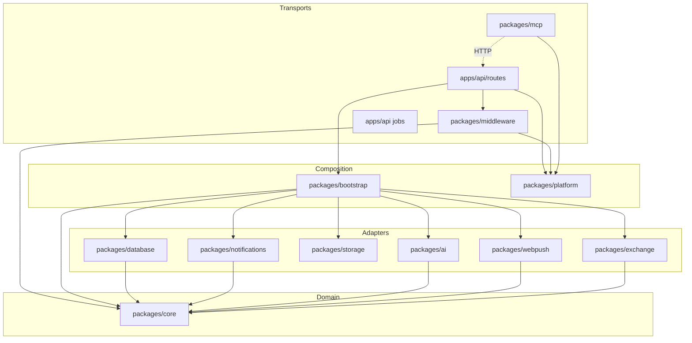

# ADR-001: Domain-Driven Design and Clean Architecture

## Status

Accepted

## Context

Split Spends has real business rules (split methods, rounding, debt simplification, who may see what) and several ways in: the HTTP API, the MCP server, background jobs. Rules must stay independent of HTTP, PostgreSQL, SMTP and AI vendors so they can be tested alone and adapters can change.

## Decision

Dependencies point inward. `packages/core` is the centre and imports no infrastructure.

### Bounded Contexts

| Context | Owns |
| ------- | ---- |
| `user` | Identity, profile, notification preferences, invited users |
| `auth` | Login codes, sessions, API tokens, signup policy |
| `friend` | Friendships (explicit plus group co-members) |
| `group` | Groups, membership and default splits |
| `expense` | Expenses, payments, split rules, comments, recurrence, built-in categories |
| `category` | User-defined expense categories |
| `balance` | Pure balance math over ledger entries: nets, pairwise debts, simplification |
| `activity` | Append-only feed |
| `receipt` | Receipt images and AI scanning |
| `assist` | Natural-language expense drafts |
| `stats` | Spending summaries |
| `push` | Push subscriptions (devices) and delivery rules |
| `invite` | Shareable group invite links |
| `reminder` | Settle-up reminders |
| `rates` | Exchange-rate tables and exact currency conversion |
| `transfer` | Importing what someone recorded on their device into their account |
| `admin` | Sign-up modes and the allowed list, requests to join, roles and disabled accounts |

### Layout Inside a Context

- Entity types with their invariants and `New`/`Apply` style constructors.
- `Repository` interfaces (ports) next to the entity.
- `Service` with use cases. Services return typed `errs.Error` values with human-readable messages; transports map kinds to status codes.
- Pure helpers (split math, debt simplification) are plain functions with table tests.

### Repository Layout

`apps/` holds only runnable apps: `api` (Go HTTP server), `mcp` (Go stdio MCP host), and the `apk` (Android), `ios` and `web` Flutter shells. Everything they are built from lives in `packages/`: the Go packages above, `packages/ledger` (the Dart twin of `packages/core`) and `packages/client` (the shared Flutter UI). Packages never import apps. The repository root is one Go module and one Dart workspace.

### Rules

The rules in `packages/archtest/boundaries_test.go` are the source of truth; each rule below names the one that enforces it, or says it is left to review.

- Core imports only itself, `github.com/google/uuid` and the standard library, and of the standard library no network, process or database packages (`net/mail`, `net/url` and `net/netip` are allowed). Checked by "core is pure".
- Repositories hold no business rules. Left to review.
- `packages/platform` is the wire contract and depends only on the standard library. Checked by "platform is stdlib only".
- Wiring happens only in `packages/bootstrap`. Checked by "only bootstrap wires repositories", "apps never wire repositories" and "the api app gets its adapters from bootstrap".
- The MCP server goes through the HTTP API (ADR-004). Checked by "mcp talks to the API, not the domain" and "the mcp app only hosts the mcp package".
- Middleware stays in the transport layer. Checked by "middleware does not touch persistence".
- Adapters (`packages/notifications`, `packages/webpush`, `packages/ai`, `packages/exchange`, `packages/storage`) do not import each other, bootstrap or transports. Checked by the "... stays an adapter" rules.

`packages/archtest` checks in `go test`, for code and test files alike:

- the import rules above for core and `packages/platform`, and that `packages/logger` and `packages/spa` use only the standard library;
- that only `packages/bootstrap` (and `packages/database` itself) imports `packages/database/repositories`, and that `apps/api` reaches adapters only through bootstrap;
- that adapters do not import each other, the transports or bootstrap, and that packages never import apps;
- that every log message written as a literal is a dotted key;
- that every rule still matches at least one package, so a rename cannot switch one off.

Left to review: that repositories hold no business rules, that `packages/platform` changes together with `docs/API.md` and the Flutter models, and that infrastructure errors start with a dotted key.

### Naming and Logging

- Short names; let the package say the context (`group.Service.Create`, not `CreateGroup`).
- Log messages are stable dotted keys (`api.server.listening`) with details as attributes. Infrastructure errors start with a dotted key; domain error messages stay human-readable.

## Consequences

### Positive

- Split and balance rules are tested without a database.
- Adapters (SMTP, Web Push, exchange rates, storage, AI, database) can be replaced behind ports.

### Negative

- More packages and explicit wiring than a single-package server.

### Neutral

- API shapes are defined separately from entities and mapped in serializers.
